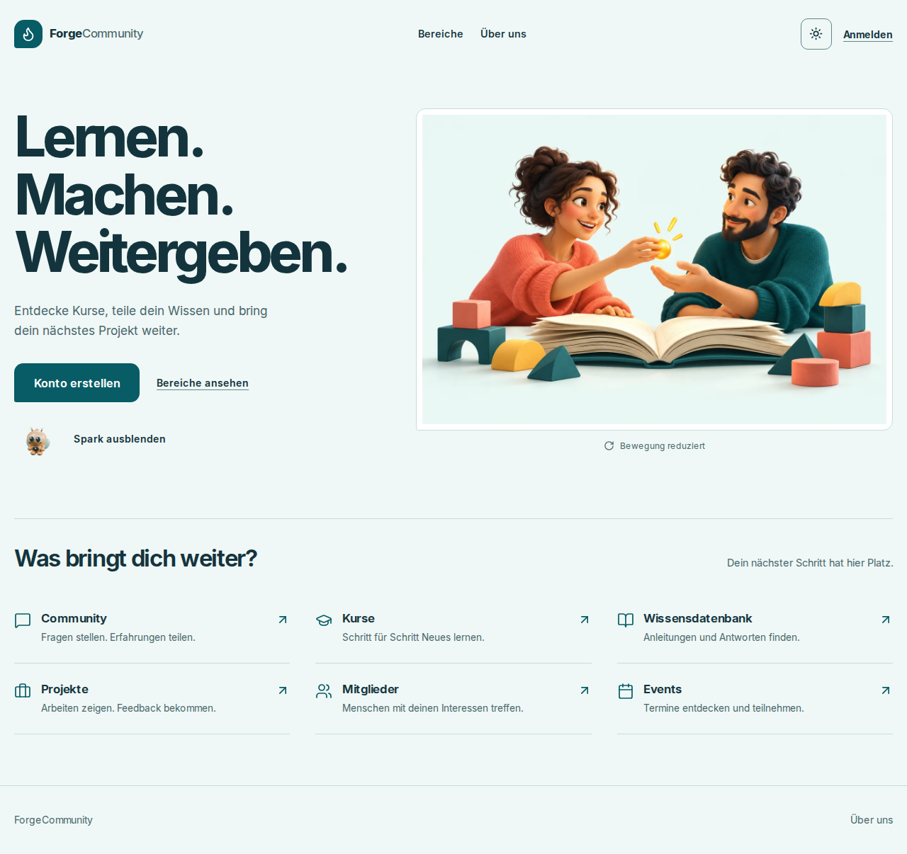
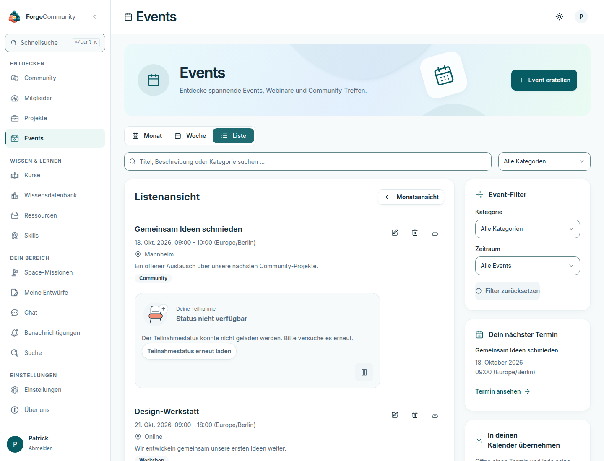

# ForgeCommunity

**Learn together. Build something. Pass it on.**

A self-hosted home for learning communities. Bring courses, conversations,
shared knowledge and member projects together in one app, with a primarily
German interface.

[](https://github.com/storminator89/forgeCommunity/actions/workflows/ci.yml)
[](LICENSE)

[Features](#features) · [Quick start](#quick-start) ·
[Local development](#local-development) · [Documentation](#documentation) ·
[Contributing](#contributing)

<a name="screenshots"></a>



The gallery below shows the current interface across the community, courses,
members and events. Authenticated views use synthetic example content. See the
[complete redesign gallery](artifacts/redesign/README.md) for all routes,
mobile and dark-mode captures, and verification details.

<details>
<summary>More screenshots from the current redesign</summary>




[Open the full desktop contact sheet](artifacts/redesign/all-pages-desktop-contact-sheet.jpg)

</details>

## Features

### Learn and teach

- **Structured courses:** nested text, video, audio, H5P and quiz lessons,
  instructor-graded assignments, prerequisites and scheduled chapter releases.
  Free self-enrollment respects course capacity.
- **A clear next step:** “Mein Lernweg” brings enrolled-course progress and the
  next available lesson together. Curated learning pathways help members plan
  their learning.
- **Questions in context:** enrolled course Q&A supports whole-course and
  lesson-linked questions, replies and instructor-selected solutions. Current
  lesson links take learners back to the relevant content.
- **Deliberate publishing:** authors save private course drafts, preview lessons
  and quizzes, review changes before publishing, and restore older versions into
  a new draft. Learners continue to see the published course until a new version
  is explicitly released.
- **Private recall practice:** authors publish a separate, versioned
  single-choice pool. Enrolled learners opt in to short sessions with corrective
  feedback, optional confidence and review scheduling. Practice stays separate
  from grades, course completion, certificates and public rankings.
- **Completion and insight:** revision-aware progress, completion-gated
  downloadable certificates with public verification, and instructor course
  analytics with CSV export.
- **Responsible rewards:** private goals and completion milestones, plus 50
  points per eligible, administrator-approved course completion with a current
  passing quiz. One “Verifiziertes Lernen” badge reflects active course rewards.
  Points and this badge can be revoked or reinstated as eligibility changes;
  public ranking and learning-badge visibility are opt-in.

### Share knowledge and work together

- **Community discussions:** topic filters, posts, replies, likes,
  author-selected solutions and content reporting.
- **Spaces:** public-to-members and private topic rooms with discussions and
  voluntary polls. Private Spaces also offer voluntary cooperative missions,
  optional soft learning weeks and personal mission bookmarks.
- **A shared knowledge base:** searchable articles, categories and tags,
  rich-text authoring, private article drafts and a resource library.
- **People and projects:** member discovery, profiles, following, skills and
  endorsements, plus project showcases with likes and feedback.
- **Events and conversations:** calendar/list views, explicit event time zones,
  calendar-file downloads, RSVP capacity checks, opt-in waitlists, channel chat
  with private attachments, and an in-app notification inbox.

The app includes light/dark themes and browser-local controls for Forge Spark,
the optional learning companion.

<details>
<summary>See course authoring, private practice and a Space mission</summary>

Save a private course draft before publishing it to learners:


Practice with a single-choice question and an optional confidence check:


Explain an idea and build on someone else's contribution in a private Space:


</details>

Screenshots show the app with synthetic example content. Capture dates,
source versions and screen-specific details are in the [screenshot gallery](docs/ui/README.md).
The Home illustration is generated fictional artwork.

### Useful to know

- Free self-enrollment is supported; displayed course prices do not include a
  checkout or paid-access workflow.
- A public Space is readable by signed-in members. Private Spaces require
  current membership or an administrator role; admins manage Space membership.
  Joining a Space does not automatically join a mission.
- Practice requires a pool published for the current course version and each
  learner's opt-in. Its questions are plain-text single choice. H5P supports
  importing and playing packages; it does not include an H5P editor.
- Chat and the notification inbox poll the server. Email, digests and external
  push delivery are not configured. Waitlist promotions appear in the app.

<a name="deployment"></a>

## Quick start

The default Docker Compose stack runs one app container with SQLite. You need
Git, Docker and Docker Compose.

```bash
git clone https://github.com/storminator89/forgeCommunity.git
cd forgeCommunity
cp .env.example .env
openssl rand -base64 32
```

Copy the generated value into `NEXTAUTH_SECRET` in `.env`. Keep
`NEXTAUTH_URL` and `NEXT_PUBLIC_APP_URL` at `http://localhost:3013` for a local
installation, then start the app:

```bash
docker compose up --build -d --wait
docker compose ps
```

Open [localhost:3013](http://localhost:3013) and create an account. Startup applies
the SQLite migrations and checks database readiness; it does not seed demo accounts.

**Use a fresh database.** Existing databases with older, pre-publication courses
are not automatically upgraded. Back them up and provision a new empty database;
do not reset them. See the [database compatibility guide](docs/COURSE-PUBLICATION-STORAGE.md).

### Configuration and persistent data

Use [`.env.example`](.env.example) as the configuration reference. Never commit
`.env` or reuse example secrets. Google login is optional; leaving both Google
OAuth values blank disables it.

- In production, set both app URLs to the canonical HTTPS origin.
- Enable `TRUST_PROXY` only behind a trusted proxy that overwrites forwarded
  client headers.
- SQLite needs a local persistent filesystem and one app instance per database
  file. Do not share the file over a network filesystem or across containers.
- Back up all three default volumes: `sqlite_data` (database, private H5P
  packages and course images), `uploads` and `private_uploads` (chat attachments).
  `docker compose down --volumes` deletes their data. Use a consistent SQLite
  backup or stop writes and preserve the database together with its journal/WAL state.

The supported Docker startup and `npm start` also run practice-data retention.
Inactive private practice history becomes deletion-eligible after 12 calendar
months; technical answer receipts after 90 days. Startup removes already eligible
data before serving. Back up and verify recovery first. See the
[practice retention policy](docs/formative-practice-learner.md#retention-and-operation).

<details>
<summary>Deploy with PostgreSQL instead</summary>

Use [`docker-compose.postgresql.yml`](docker-compose.postgresql.yml). In `.env`,
set an independent strong `POSTGRES_PASSWORD`, the matching `POSTGRES_USER` and
`POSTGRES_DB`, and a `DATABASE_URL` using the Compose service hostname `db` and an
explicit schema target, for example `?schema=public`.
The explicit Compose stack selects the PostgreSQL provider at build and runtime.

PostgreSQL schema initialization is an explicit step. For a **verified empty
schema**, run:

```bash
docker compose -f docker-compose.postgresql.yml build app
docker compose -f docker-compose.postgresql.yml up -d db
docker compose -f docker-compose.postgresql.yml run --rm --entrypoint node app \
  scripts/db-deploy.mjs --initialize-empty-schema
docker compose -f docker-compose.postgresql.yml run --rm --entrypoint node app \
  scripts/assert-course-publication-ready.mjs
docker compose -f docker-compose.postgresql.yml up -d
```

Initialization refuses pre-existing schema objects. The normal entrypoint checks
readiness but does not migrate PostgreSQL on startup. Do not use `prisma db push`
to bypass tracked SQL migrations. Keep the database, `h5p_data`, `course_assets`,
`uploads` and `private_uploads` backed up together. This path does not convert
populated legacy course databases; read the
[storage and compatibility guide](docs/COURSE-PUBLICATION-STORAGE.md) before deployment.

</details>

## Local development

Use Node.js 24 ([`.nvmrc`](.nvmrc)), npm 11 and the committed lockfile. Clone the
repository and prepare `.env` with an independent secret as in the quick start.
Select SQLite **before installation**, so postinstall generates the matching
Prisma client:

```bash
export DATABASE_PROVIDER=sqlite
export DATABASE_URL="file:$PWD/data/forge.db"
mkdir -p data
npm ci
npm run db:deploy
npm run db:publication:ready
npm run dev
```

Use a new, empty database at that absolute path. Exported values override the
placeholder in `.env`. The development server runs on port 3013.

`npm run dev` does not start the retention worker. New learner-practice writes
require a recent worker heartbeat; to exercise practice end to end, use Docker
or the production startup path:

```bash
npm run build
npm start
```

Keep provider/database settings consistent for generation, build and runtime.
After switching providers or editing `prisma/schema.prisma`, run
`npm run db:generate`. The PostgreSQL schema is canonical; the SQLite schema is
generated. Keep private course images in persistent `data/course-assets` storage
outside `public/`, or set `COURSE_ASSET_STORAGE_PATH` to another private location.

## Technology

Next.js 16 App Router · React 19 · TypeScript · Tailwind CSS 4 · Radix/shadcn UI ·
NextAuth.js 4 · Prisma 7 · SQLite or PostgreSQL

## Documentation

- Learning: [course editor](docs/COURSE-EDITOR.md),
  [chapter releases](docs/CHAPTER-RELEASES.md),
  [prerequisites](docs/COURSE-PREREQUISITES.md),
  [H5P](docs/H5P.md) and [learning pathways](docs/VERIFIED-LEARNING-PATHWAYS.md)
- Practice: [authoring](docs/formative-practice-authoring.md),
  [learner controls and retention](docs/formative-practice-learner.md)
- Community: [Spaces](docs/SPACES.md),
  [cooperative missions](docs/COOPERATIVE-MISSIONS.md),
  [mission bookmarks](docs/PRIVATE-MISSION-BOOKMARKS.md),
  [polls](docs/SPACE-POLLS.md) and [accepted solutions](docs/ACCEPTED-SOLUTIONS.md)
- Participation: [event waitlists](docs/EVENT-WAITLIST.md),
  [notifications](docs/ACTIONABLE-NOTIFICATION-INBOX.md) and
  [reward rules and private goals](docs/RESPONSIBLE-REWARDS.md)
- Project reference: [design system](design.md),
  [screenshots](docs/ui/README.md), [route inventory](e2e/route-sweep-manifest.ts),
  [database compatibility](docs/COURSE-PUBLICATION-STORAGE.md) and
  [CI workflow](.github/workflows/ci.yml)

<a name="testing-and-evidence"></a>

## Contributing

Found a bug or have an idea? [Open an issue](https://github.com/storminator89/forgeCommunity/issues).
Focused pull requests with relevant regression tests are welcome.

```bash
npm run typecheck
npm run lint -- --max-warnings 0
npm test -- --runInBand
npm run test:styles
npm run test:next-eslint-fork
```

Database-backed tests require a SQLite-generated client and a disposable SQLite
database. Regenerate for your intended provider before building. Use the
[CI workflow](.github/workflows/ci.yml) for the full ordered checks and disposable
browser-test setup; never target a personal or production database. For dependency
changes, follow the [Next ESLint fork maintenance guide](docs/NEXT-ESLINT-FORK.md).
Mention any checks you could not run in your pull request.

## License

Licensed under the [Apache License 2.0](LICENSE).
