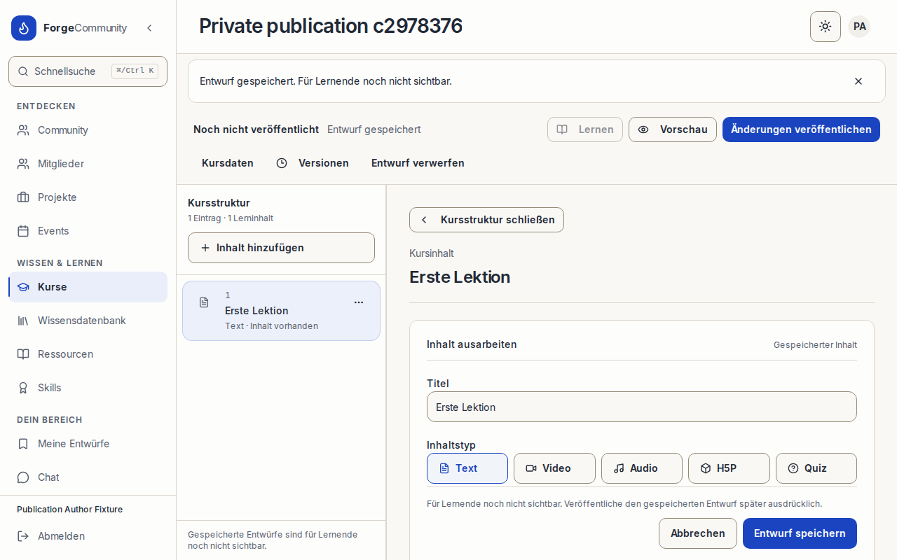
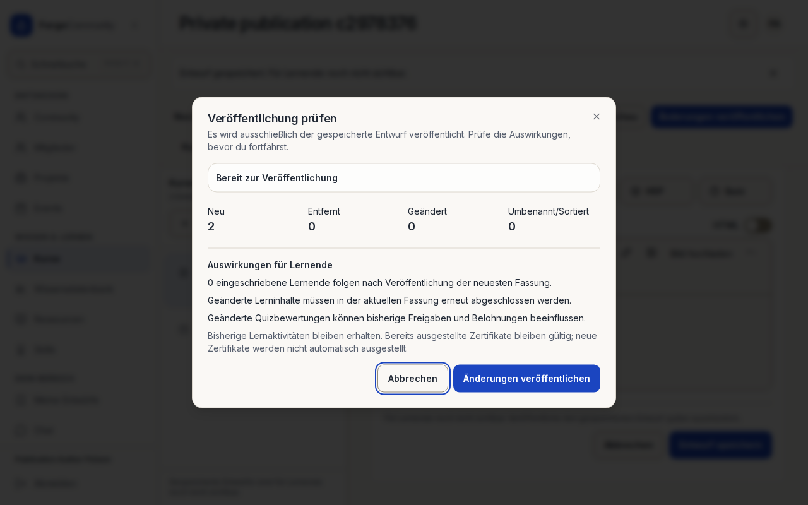
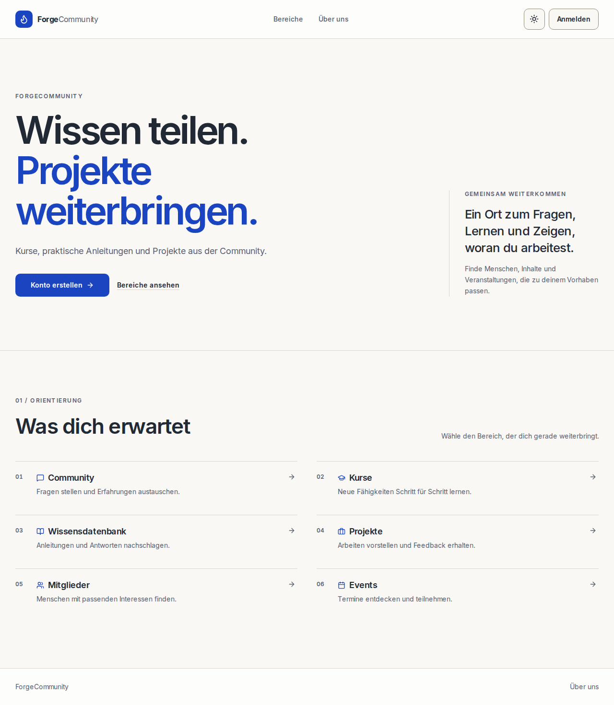
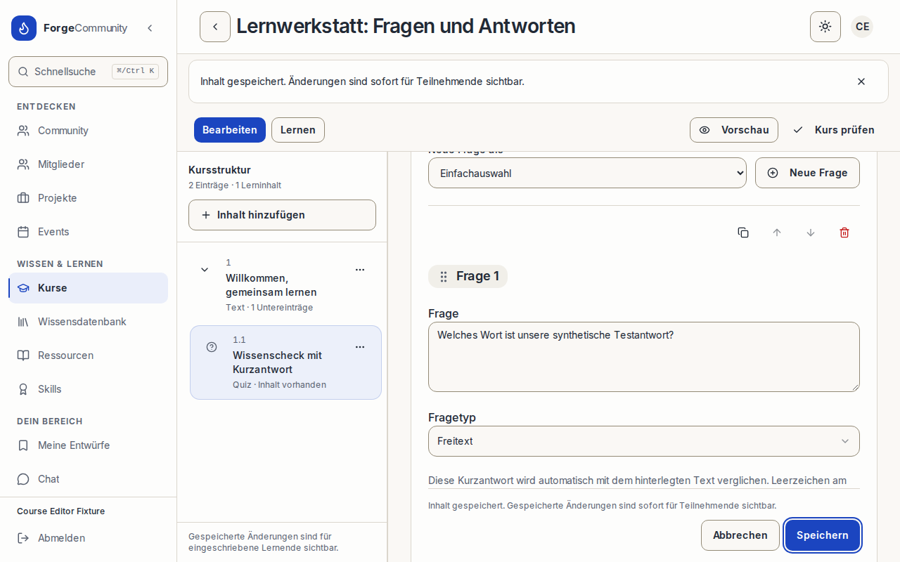
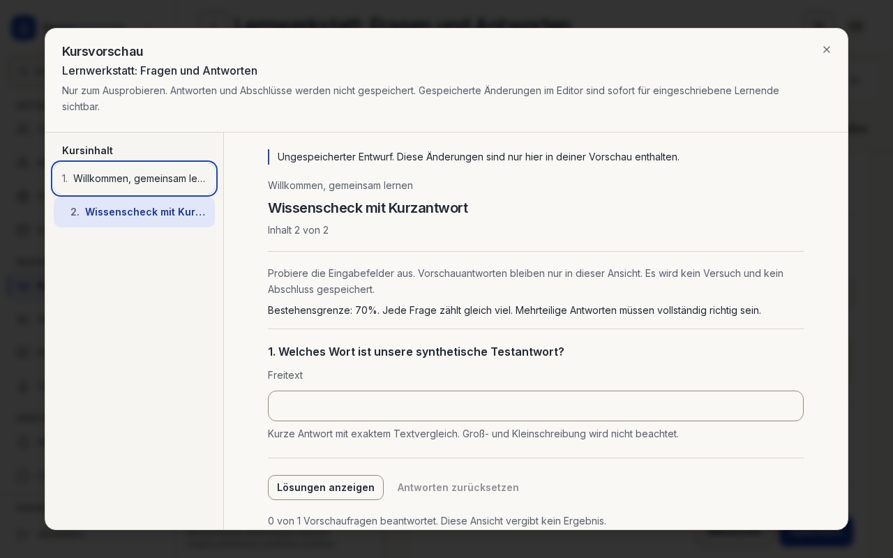
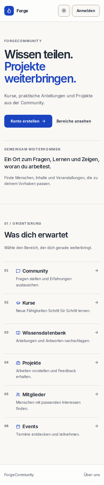

# ForgeCommunity

[](https://github.com/storminator89/forgeCommunity/actions/workflows/ci.yml)
[](LICENSE)

A self-hosted community learning app for sharing knowledge, taking courses,
discussing questions, and showing work. The interface is primarily German.

Built with Next.js 16, React 19, TypeScript, Tailwind CSS 4, Radix/shadcn UI,
NextAuth.js 4, and Prisma 7. SQLite is the default single-container deployment;
PostgreSQL is an explicit alternative.

[Get started](#local-development) · [Features and routes](#features-and-routes) ·
[Deployment](#deployment) · [Testing](#testing-and-evidence) ·
[Report a bug](https://github.com/storminator89/forgeCommunity/issues)

## Screenshots

These are unedited screenshots of the app running in CI with disposable,
synthetic accounts and courses. The new authoring captures show a saved private
draft and the explicit publication review. They come from PR #39's Playwright
journey on the [reviewed source tree](https://github.com/storminator89/forgeCommunity/commit/326f4798fc59ccb8c15420d95eaf79cb91bec191).
The [screenshot provenance](docs/ui/README.md) records the exact CI merge
commit, artifact, dimensions, hashes, and limits. That first CI run's new
authoring browser journey passed; its overall checks had separate outdated
fixture expectations, so these images alone are not a release validation.





<details>
<summary>Earlier landing and immediate-save editor captures</summary>

The four captures below are historical, pre-phase-2 evidence from merged-main
Chromium run `38717775096` on `1025767`. The landing pages contain no member
data. The earlier quiz authoring and preview used a disposable synthetic
account and course, not production activity. They do not depict the new
private-draft workflow.



Earlier quiz authoring after save, 1280px light mode. The independently scrollable editor
panel is positioned at the question and save controls; not every field is shown.
Synthetic example content.



<details>
<summary>Earlier course preview, 1280px light mode, synthetic unsaved draft</summary>

The course preview displays a local unsaved quiz draft. Rehearsal answers stay
inside the preview and do not record a learner attempt or completion.



</details>

<details>
<summary>Public landing page, 390px mobile light mode</summary>



</details>

</details>

## Features and routes

| Area | Available in the app | Routes |
| --- | --- | --- |
| Community | Posts and replies, topic filters, likes, bounded feed/comment pagination, author-selected solutions, and reporting | `/community` |
| Members | Search/filter, grid/list views, profiles, following, and skill endorsements | `/members`, `/profile/[id]` |
| Courses | Private course drafts, review/publish/version restore, free self-enrollment with capacity checks, nested text/video/audio/H5P/quiz lessons, revision-aware progress, and completion-gated certificate downloads | `/courses`, `/courses/authoring`, `/courses/new`, `/courses/[courseId]/contents` |
| Personal learning | Optional private learning goals, completion milestones, and course-reward history; administrator-approved quiz learning can qualify for a verified-learning badge and opt-in ranking | `/courses/goals`, community reward panels, profiles |
| Knowledge base | Published articles, category/tag search, rich-text authoring, and private drafts | `/knowledgebase`, `/knowledgebase/[id]`, `/knowledgebase/new-article`, `/knowledgebase/drafts` |
| Resources and projects | Resource browsing/details, project submission/details, likes and project comments | `/resources`, `/resources/[id]`, `/projects/new`, `/projects/[projectId]`, `/showcases` |
| Events | Calendar/list discovery, upcoming events, creation, and RSVP with capacity checks | `/events` |
| Skills and search | Skill directory, personal skills, and cross-content discovery with URL-backed search filters | `/skills`, `/search` |
| Chat and notifications | Channel conversations, message editing, private attachments, and a recipient-scoped in-app inbox with links to available targets | `/chat`, `/notifications` |
| Account and staff | Registration/login, profile/settings, administrator dashboard/user management, and role-limited moderation | `/register`, `/login`, `/settings`, `/admin/dashboard`, `/admin/users`, `/moderation` |
| Public pages | Product introduction, about page, and certificate verification | `/`, `/about`, `/verify-certificate/[certificateId]` |

`/courses/[courseId]` hands off to the course-content route. Existing article-edit
URLs remain supported. The [route inventory](e2e/route-sweep-manifest.ts) tracks
every App Router page, including redirects.

### Product boundaries

- Paid courses can show a price, but there is no integrated checkout or paid
  access-grant workflow. Free self-enrollment is the supported join flow.
- Progress is server-owned and content-revision aware. Non-quiz lessons use an
  explicit completion action; quizzes are graded on the server. An issued
  certificate remains a historical credential after later course edits.
- A saved course draft is private. The member-only course catalogue and enrolled
  learners see the latest published version only; a new course is not
  discoverable or enrollable before its first publication. Changed lesson bodies
  must be completed again in the current version, while earlier activity and
  issued certificates remain.
- H5P packages can be imported, reused, and played in an isolated iframe. There
  is no built-in H5P authoring tool or centralized xAPI result store. External
  media providers must permit embedding. See [H5P](docs/H5P.md).
- Chat and the in-app inbox poll the server. No server-push/SSE delivery, email
  sender, digest, or external push service is configured. Browser chat alerts
  depend on local permission and settings. See [notifications](docs/ACTIONABLE-NOTIFICATION-INBOX.md).
- Public course-reward ranking is opt-in. Private goals and contribution
  milestones do not award posting points or streaks. See [reward rules](docs/RESPONSIBLE-REWARDS.md).
- The member directory is not server-paginated. Unicode/collation and freshness
  semantics need an explicit decision before changing that contract.

### Course authoring

Course owners can find private and published courses under **Meine Kursentwürfe**
at `/courses/authoring`. In the author workspace they edit metadata and nested
lessons, explicitly save a private draft, then use **Änderungen veröffentlichen**
to review blockers and learner impact before publishing. Saving alone never
changes the live course. The review shows added, removed, changed, and
renamed/reordered content and warns about possible completion/reward changes.

**Vorschau** includes the saved draft and, where present, a local unsaved lesson
edit. Reading and quiz rehearsal there do not save attempts or completion.
**Lernen** shows the current published version, if one exists. **Versionen** can
copy an older publication into a new private draft; it does not roll back the
live version until that draft is reviewed and published. **Entwurf verwerfen**
resets to the current publication, or clears an unpublished course's draft,
without deleting the course. Unsaved-change prompts protect local edits;
revision conflicts ask authors to compare/reload rather than silently merge.
Learners do not get authoring controls. See the [course editor guide](docs/COURSE-EDITOR.md).

## Local development

### Prerequisites

- Node.js 24 (`.nvmrc`) and npm 11; install with the committed lockfile
- Git
- A local writable filesystem for SQLite, or a separately configured PostgreSQL
  database; CI exercises PostgreSQL 16

### Start with SQLite

```bash
git clone https://github.com/storminator89/forgeCommunity.git
cd forgeCommunity
cp .env.example .env
```

Set `NEXTAUTH_SECRET` in `.env` to an independently generated value:

```bash
openssl rand -base64 32
```

Keep `NEXTAUTH_URL` and `NEXT_PUBLIC_APP_URL` at `http://localhost:3013` for this
local setup. Do not commit `.env` or reuse example/CI secrets. Optional Google
OAuth is disabled when its two environment values are blank.

Select SQLite **before installation**, so the postinstall step generates the
correct Prisma client. Use a **new, empty** database at an absolute path for
phase 2; do not reuse a development database containing older courses:

```bash
export DATABASE_PROVIDER=sqlite
export DATABASE_URL="file:$PWD/data/forge.db"
mkdir -p data
npm ci
npm run db:deploy
npm run db:publication:ready
npm run dev
```

Open [localhost:3013](http://localhost:3013) and create an account through the
registration page. The exported database values take precedence over the
placeholder in `.env`; replace that placeholder if you prefer to configure the
same absolute path entirely in `.env`.

The read-only readiness command checks the recorded migration names/checksums,
saved drafts, and active-publication pointers. If it fails, stop and inspect
the database; no setup step here deletes or converts existing data. Back up an
older database and provision a fresh one for this release. Keep course images
in private, persistent `data/course-assets` storage outside `public/` and back
them up together with the database. Set `COURSE_ASSET_STORAGE_PATH` if you
need another private, persistent location; it cannot point inside `public/`
or through symlinks.

An optional seed is restricted to a disposable, non-production database:

```bash
ALLOW_DEMO_SEED=true npm run db:seed
```

It creates example content and independent random account passwords that are
not printed. Those accounts are not a documented login mechanism. The seed is
not an idempotent production migration.

### Everyday commands

```bash
npm run dev                  # Development server on port 3013
npm run db:generate          # Regenerate SQLite schema and selected Prisma client
npm run db:deploy            # Apply the selected provider's tracked SQL history
npm run db:publication:ready # Read-only phase-2 schema/data readiness guard
npm run build                # Webpack production build + standalone preparation
npm run start                # Run the prepared standalone build on port 3013
```

Keep the same provider and database settings for generation, build, and runtime.
After switching providers or editing `prisma/schema.prisma`, rerun
`npm run db:generate`. Edit the canonical PostgreSQL schema, not the generated
`prisma/schema.sqlite.prisma`.

## Deployment

### Default Docker stack: SQLite

```bash
cp .env.example .env
# Set an independent strong NEXTAUTH_SECRET and the canonical app URLs in .env.
docker compose up --build -d --wait
docker compose ps
```

The default Compose file sets `DATABASE_PROVIDER=sqlite` and
`DATABASE_URL=file:/app/data/forge.db`. The app is exposed on port 3013.
`docker-compose.sqlite.yml` is a compatibility alias. Startup applies ordered,
checksummed SQLite migrations transactionally and does not seed demo accounts.

Persistent volumes hold:

- `sqlite_data`: the database, private H5P packages, and private course images
- `uploads`: article/project and older public image uploads
- `private_uploads`: private chat attachments

`docker compose down --volumes` deletes these volumes and their data. Back up
the database **and all upload/package storage**. For SQLite, use a consistent
online backup or stop writes and copy the database with its journal/WAL state.
Use a local persistent filesystem and one application instance per SQLite file;
do not share that file over a network filesystem or between app containers.
SQLite's case-insensitive matching remains limited for non-ASCII text.
The SQLite Compose entrypoint applies migrations and runs the read-only
publication readiness guard before serving. It refuses an old database with
courses lacking drafts; it does not erase those courses.
The normal Docker command and `npm start` complete a private formative-practice
retention sweep after readiness and before serving, then repeat bounded sweeps
every 15 minutes. Learner practice writes return 503 if the database heartbeat
is missing or older than 45 minutes. Back up and rehearse recovery before
deploying: startup deletes already eligible private practice data. Running
`start:standard` or `server.js` directly does not launch this worker. See the
[learner practice retention policy](docs/formative-practice-learner.md).

Configure canonical HTTPS `NEXTAUTH_URL` and `NEXT_PUBLIC_APP_URL` in production.
Set `TRUST_PROXY=true` only behind a trusted proxy that overwrites forwarded
client headers. Rehearse upgrades against a backed-up staging copy. Authentication
security upgrades may require rotating `NEXTAUTH_SECRET`, which signs everyone
out; see the [security upgrade notes](docs/SECURITY-MODERNIZATION.md).

### PostgreSQL option

Use `docker-compose.postgresql.yml` with an independent `POSTGRES_PASSWORD` and
a `DATABASE_URL` that uses the Compose service hostname `db`. Back up
`postgres_data`, `h5p_data`, `course_assets`, `uploads`, and `private_uploads`
together. `course_assets` mounts private `/app/data/course-assets`; keep it
persistent and outside the public upload volume.

The PostgreSQL stack **does not migrate its schema on startup**. Select
`DATABASE_PROVIDER=postgresql`, provide the connection URL, and generate the
matching client before running the deployment runner. Phase 2 supports a
**verified empty schema**: `npm run db:deploy -- --initialize-empty-schema`
installs the fixed baseline and upgrades in one transaction and refuses
pre-existing schema objects. Then run `npm run db:publication:ready` with the
same provider and URL. The Compose entrypoint runs this read-only guard again
and refuses startup if it fails.

The deployment runner also has these history-repair paths, but they are **not
phase-2 upgrade support for a database with pre-publication courses**:

- **Tracked existing installation:** `npm run db:deploy` checks history and
  applies the remaining ordered upgrades.
- **Legacy schema with `SkillEndorsement` but no upgrade history:** after verifying
  that exact expected structure, use
  `npm run db:deploy -- --baseline-current-schema`. Do not use this option to
  bless an arbitrary current or populated schema.

An older database may accept additive SQL and still fail phase-2 readiness
because historical courses lack saved drafts. Back it up and provision a new
empty database; do not reset or delete it automatically. See [publication
storage](docs/COURSE-PUBLICATION-STORAGE.md).

For the Compose deployment, run the appropriate command in a one-off app
container before starting the application, for example for a verified empty schema:

```bash
docker compose -f docker-compose.postgresql.yml build app
docker compose -f docker-compose.postgresql.yml up -d db
docker compose -f docker-compose.postgresql.yml run --rm --entrypoint node app \
  scripts/db-deploy.mjs --initialize-empty-schema
docker compose -f docker-compose.postgresql.yml run --rm --entrypoint node app \
  scripts/assert-course-publication-ready.mjs
docker compose -f docker-compose.postgresql.yml up -d
```

The runner checks schema structure, keys, checksums, and the URL schema. Do not
run `prisma db push` with the current schema before initialization or baselining:
it bypasses SQL-only constraints. Both providers require a reviewed, numbered
migration for schema changes; never edit already-applied SQL files. See
[deployment implementation](scripts/db-deploy.mjs),
[SQLite migrations](prisma/sqlite-migrations), and
[PostgreSQL upgrades](prisma/postgresql-upgrades).

## Testing and evidence

```bash
npm run typecheck
npm run lint -- --max-warnings 0
npm test -- --runInBand
npm run test:styles
npm run test:next-eslint-fork
```

The database-backed Jest suites need a SQLite-generated client and disposable
SQLite settings. After testing, regenerate the client for the intended build
provider. The [CI workflow](.github/workflows/ci.yml) is the complete reference
for ordered generation, migration checks, build, and runtime smokes.

CI separates application `quality` from the unchanged strict
`npm audit --audit-level=high` job. The `validate` aggregate succeeds only when
both succeed. Independent jobs exercise PostgreSQL upgrades, Docker/SQLite/H5P,
and real Chromium journeys with disposable data. Browser screenshots are retained
as workflow artifacts for seven days; selected documentation images are kept in
`docs/ui` with provenance.

Browser QA requires a production build, official Playwright Chromium,
`BROWSER_QA_DISPOSABLE_DB=1`, `DATABASE_PROVIDER=sqlite`, a loopback base URL, and
an absolute database path named `forge-browser-qa.db`. It starts its own standalone
server; never aim it at a production or personal database. Run
`npm run test:browser` only in that prepared environment. The route sweep tests
1280px and 320px; the journey suites also run at 390px. Some dynamic route-sweep
responses are synthetic API fixtures, as documented in [route-sweep coverage](docs/ROUTE-SWEEP-QA.md).

The **historical, pre-phase-2** verified merged-main baseline is
[run 38717775096](https://github.com/storminator89/forgeCommunity/actions/runs/38717775096)
on `102576735dd3b7cb23c8657e3a74098228582bc6`, checked on 15 October 2026.
All six jobs passed: application quality, strict security audit, PostgreSQL
release gate, Docker smokes, Chromium browser QA, and aggregate validation.
The screenshot gallery comes from that run's actual app captures. These dated
results apply to that commit; they are not a perpetual security guarantee or
proof that later code has passed. See the [course editor guide](docs/COURSE-EDITOR.md)
for its current workflow/acceptance scope and the
[release handoff](docs/RELEASE-HANDOFF-2026-10-15.md) for earlier integration history.

No CI run on this phase-2 documentation/source head is claimed here. The
current workflow defines quality, strict audit, browser QA, and fresh
PostgreSQL publication-runtime checks; their results must be inspected on the
exact commit before claiming the phase-2 release has passed. The checked-in
course editor screenshots describe the earlier author journey and are not
phase-2 publication-browser evidence; new captures remain pending real CI
artifacts and provenance review.

This is repository integration evidence. Production deployment still requires
operational review and a backed-up migration rehearsal. Chromium viewport tests
and source-calculated contrast checks do not establish WCAG conformance,
assistive-technology compatibility, or Safari/Firefox behavior.

### Styling and dependency maintenance

Tailwind CSS 4 sets a minimum browser floor of Safari 16.4, Chrome 111, and
Firefox 128, as described in the [official upgrade guide](https://tailwindcss.com/docs/upgrade-guide).
The current browser suite uses Chromium; the other engines have not been
validated by that suite. Keep `npm run test:styles` and route-level visual QA
when changing tokens or CSS utilities.

The project temporarily owns a pinned fork of `@next/eslint-plugin-next@16.3.8`
that replaces its vulnerable glob dependency while retaining Next rule behavior.
The checked-in source/archive, parity tests, and retirement procedure are in
[Next ESLint fork maintenance](docs/NEXT-ESLINT-FORK.md). Do not replace it with
the original same-version archive, remove framework rules, or weaken the audit
gate during dependency updates. The scoped Istanbul/YAML override also needs
compatibility review; see [dependency history](docs/DEPENDENCY-SECURITY-2026-10-15.md).

## Design and documentation

The shared [design contract](design.md) defines warm paper/charcoal surfaces,
sparing blue accents, Inter typography, and task-specific workbench layouts.
The redesign follows the inspected [Hallmark source](https://github.com/Nutlope/hallmark)
within the existing routes and product boundaries. Screenshots show real app
rendering; no generated mock interfaces or added browser/phone chrome are used.

- [Course editor](docs/COURSE-EDITOR.md)
- [Staged publication storage and fresh-database boundary](docs/COURSE-PUBLICATION-STORAGE.md)
- [H5P import, storage, and player](docs/H5P.md)
- [Responsible rewards and private learning goals](docs/RESPONSIBLE-REWARDS.md)
- [Accepted solutions](docs/ACCEPTED-SOLUTIONS.md)
- [Actionable notifications](docs/ACTIONABLE-NOTIFICATION-INBOX.md)
- [Current release handoff and historical evidence](docs/RELEASE-HANDOFF-2026-10-15.md)
- [Security modernization](docs/SECURITY-MODERNIZATION.md)
- [Product roadmap](docs/REDESIGN-ROADMAP-2026-10-14.md)

Older audit and modernization reports are historical snapshots, not current
feature/support promises. The separate earlier course proposal in PR #6 is not
part of the merged learning implementation.

## Project structure

```text
app/          App Router pages and API handlers
components/   Shared UI and feature components
lib/          Client helpers and server-owned business rules
e2e/          Disposable Playwright journeys and route inventory
__tests__/    Jest API, UI, migration, and source regressions
prisma/       Canonical/generated schemas and provider-specific SQL history
scripts/      Deployment, dependency guards, and runtime smokes
vendor/       Pinned Next ESLint plugin source and package archive
docs/         Feature guides, design/QA evidence, and screenshots
public/       Static assets; generated H5P runtime is prepared at build time
```

## Contributing and license

Open an [issue](https://github.com/storminator89/forgeCommunity/issues) for a
bug or proposal, or submit a focused pull request with relevant regressions.
Run the applicable checks above and disclose any that were not run.

Licensed under the [Apache License 2.0](LICENSE).
