> **Experimental Cloudflare / Sites branch**
>
> You are viewing `cloudflare-sites`, an optional, partial Workers/D1 adaptation.
> For the standard self-hosted setup and first-time use, select
> [`main`](https://github.com/storminator89/forgeCommunity/tree/main).
> This branch requires its own Sites project and D1 `DB` binding. Read the
> [Cloudflare / Sites setup and limitations](docs/CLOUDFLARE_SITES.md) before
> installing. The product gallery below describes upstream features; it is not
> a compatibility guarantee for this branch. The Docker, SQLite and PostgreSQL
> setup sections below apply to main.

# ForgeCommunity

**Learn together. Build something. Pass it on.**

A self-hosted home for learning communities. Bring courses, conversations,
shared knowledge and member projects together in one app, with a primarily
German interface.

[](https://github.com/storminator89/forgeCommunity/actions/workflows/ci.yml)
[](LICENSE)

[Product gallery](#product-gallery) · [Quick start](#quick-start) ·
[Local development](#local-development) · [Documentation](#documentation) ·
[Contributing](#contributing)

<a name="screenshots"></a>

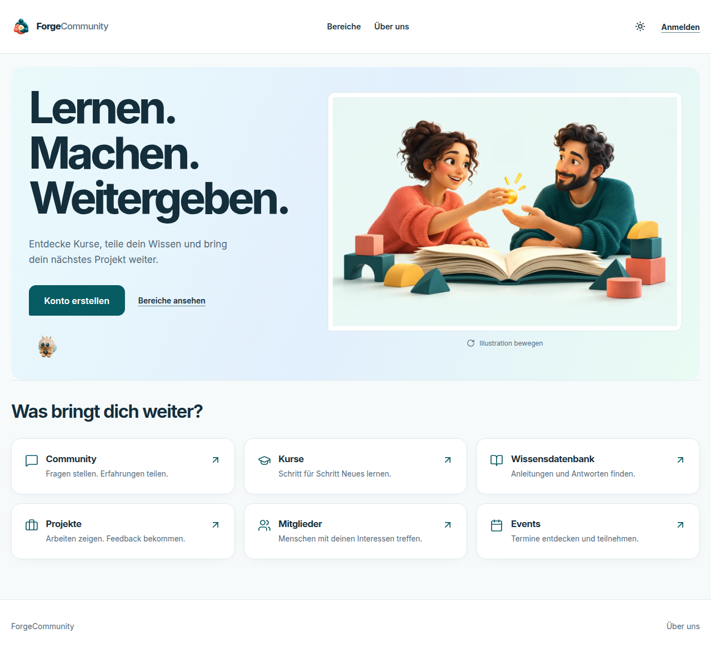

## Product gallery

ForgeCommunity brings learning, knowledge sharing and community activity into
one self-hosted app. The interface is primarily German. Browse the gallery by
what people can do; each card pairs a short feature summary with a current
screen. Authenticated screenshots use disposable synthetic accounts and
example content.

### Learn and teach

<table>
<tr>
<td width="50%" valign="top">
<a href="artifacts/redesign/after-courses-light-1440.png">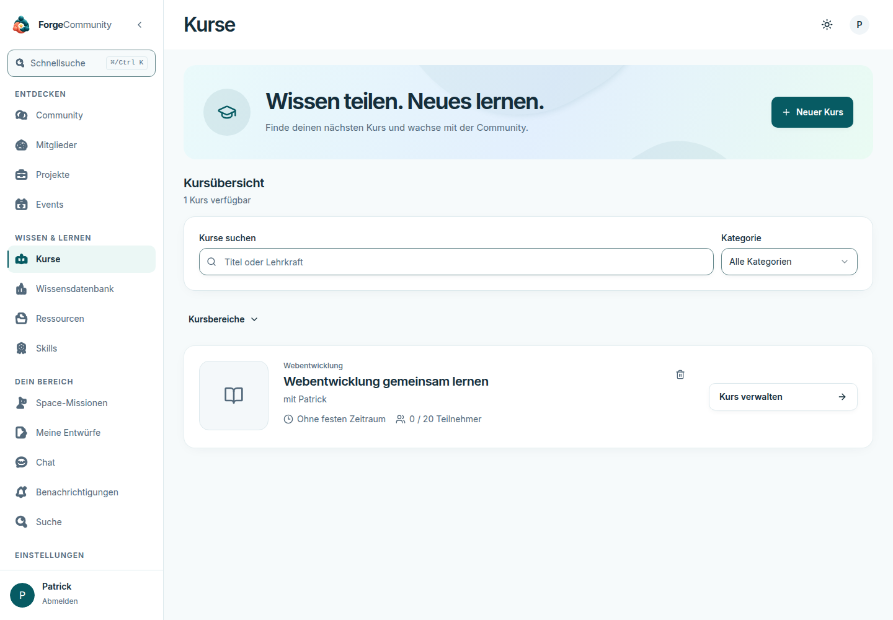</a>
<h3>Courses and lessons</h3>
<p>Members discover courses and enroll for free. Courses combine nested text, video, audio, H5P and quiz lessons, with prerequisites, capacity checks and scheduled chapter releases.</p>
</td>
<td width="50%" valign="top">
<a href="docs/ui/readme/course-draft-authoring-desktop.png"></a>
<h3>Authoring and publishing</h3>
<p>Instructors build private drafts, preview lessons and quizzes, review learner impact, then publish a version. Older versions can be restored into a new draft without changing the live course.</p>
</td>
</tr>
<tr>
<td width="50%" valign="top">
<a href="artifacts/redesign/all-pages-desktop/route-sweep.pw.ts-every-Ap-a9f22-nder-courses-journey-light--desktop-chromium/courses-journey-light.png">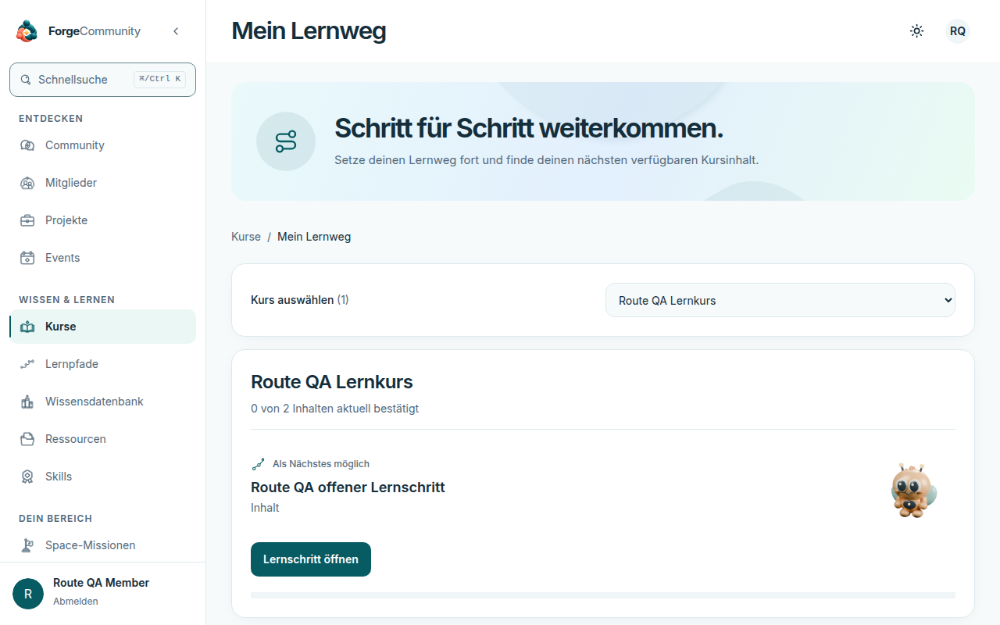</a>
<h3>Learning journeys</h3>
<p>“Mein Lernweg” collects enrolled-course progress and the next available step. Curated pathways connect two to four courses; private goals and milestones help learners track their own plans.</p>
</td>
<td width="50%" valign="top">
<a href="docs/ui/readme/practice-question-desktop.png">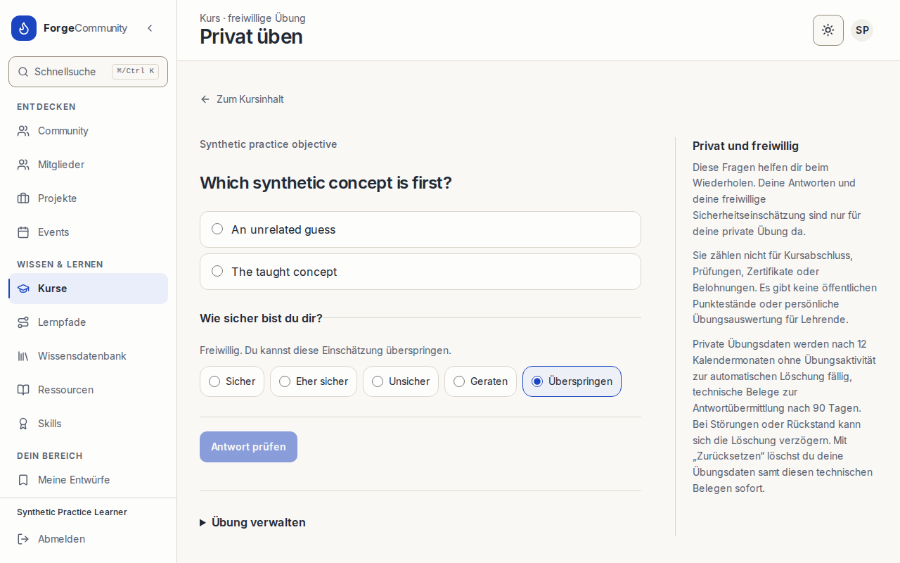</a>
<h3>Practice and course Q&amp;A</h3>
<p>Opt-in recall sessions give learners corrective feedback and optional confidence checks, separate from grades. Course questions can link to a lesson; instructors reply and select solutions. Assignments support instructor grading.</p>
</td>
</tr>
<tr>
<td width="50%" valign="top">
<a href="artifacts/redesign/all-pages-desktop/route-sweep.pw.ts-every-Ap-c9f0a-ute-course-analytics-light--desktop-chromium/courses-courseId-analytics-light.png">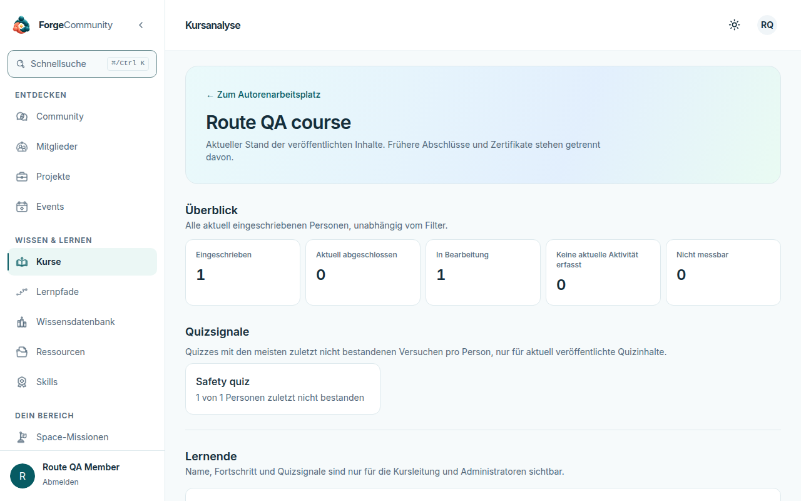</a>
<h3>Progress, certificates and insight</h3>
<p>Revision-aware completion powers downloadable certificates and public certificate verification. Instructors can review course analytics and export CSV reports.</p>
</td>
<td width="50%" valign="top">
<a href="artifacts/redesign/after-community-light-1440.png">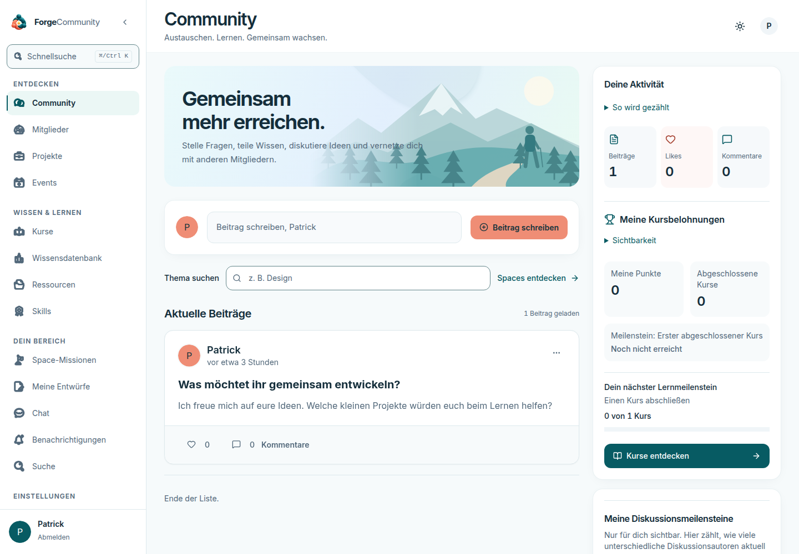</a>
<h3>Private goals and responsible rewards</h3>
<p>Private goals, milestones and reward history stay personal. Eligible approved course completions can earn points and a verified-learning badge; public ranking and badge visibility are opt-in.</p>
</td>
</tr>
</table>

### Share knowledge and build together

<table>
<tr>
<td width="50%" valign="top">
<a href="artifacts/redesign/after-community-light-1440.png"></a>
<h3>Community discussions</h3>
<p>Topic-based posts, replies, likes and author-selected solutions make it easy to exchange ideas. Members can browse a bounded feed and report content for moderation.</p>
</td>
<td width="50%" valign="top">
<a href="docs/ui/readme/space-mission-light-768.png">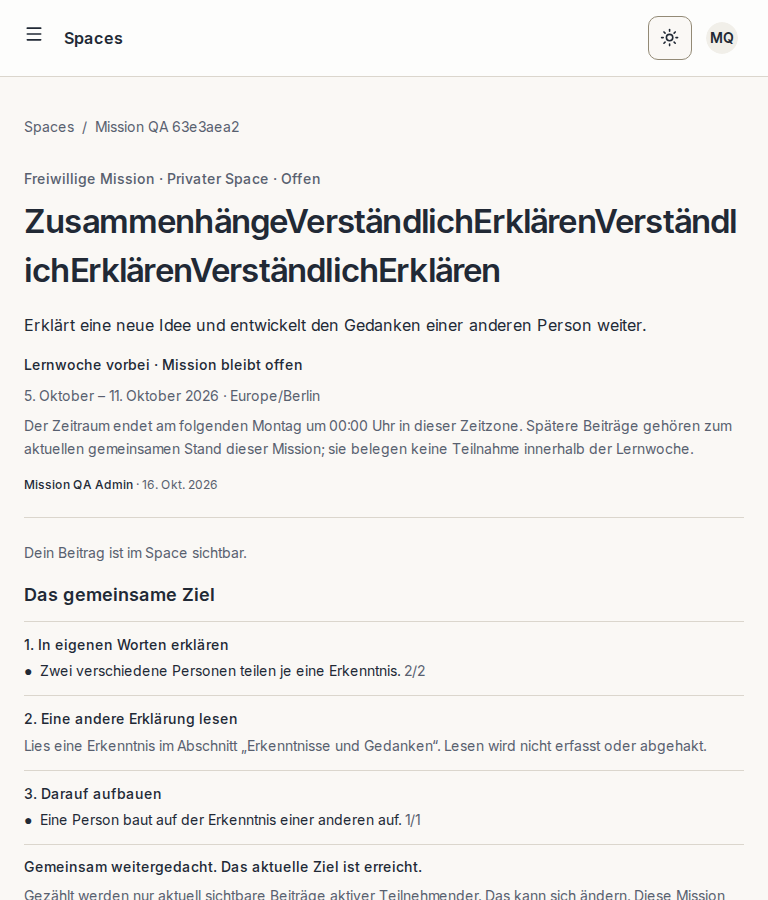</a>
<h3>Spaces, polls and missions</h3>
<p>Public and private Spaces host focused discussions and voluntary polls. Private Spaces can run small cooperative teach-back missions with optional learning weeks, bookmarks and invitations.</p>
</td>
</tr>
<tr>
<td width="50%" valign="top">
<a href="artifacts/redesign/after-article-new-light-1440.png">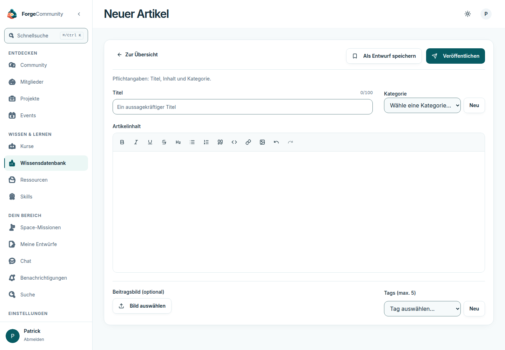</a>
<h3>Knowledge base and resources</h3>
<p>Search published articles by category and tag, write with the rich-text editor, and keep article drafts private. A separate resource library organizes useful links and media.</p>
</td>
<td width="50%" valign="top">
<a href="artifacts/redesign/after-members-light-1440.png">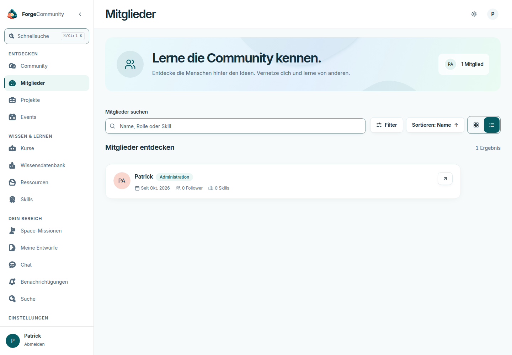</a>
<h3>Members, profiles and skills</h3>
<p>Find people by name, role or skill, then explore profiles, follow members and give skill endorsements. People can share a bio, projects and professional links.</p>
</td>
</tr>
<tr>
<td width="50%" valign="top">
<a href="artifacts/redesign/after-projects-light-1440.png">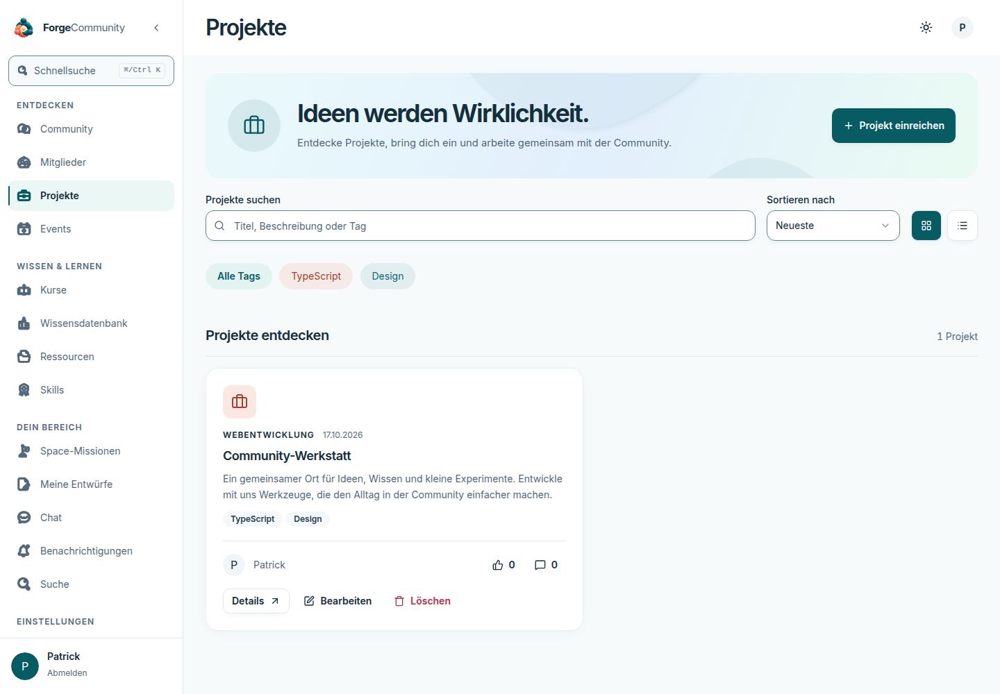</a>
<h3>Projects and showcases</h3>
<p>Members submit projects, browse showcases, and exchange likes and comments around work in progress.</p>
</td>
<td width="50%" valign="top">
<a href="artifacts/redesign/all-pages-desktop/route-sweep.pw.ts-every-Ap-6e3fd-ge-tsx-render-events-light--desktop-chromium/events-light.png">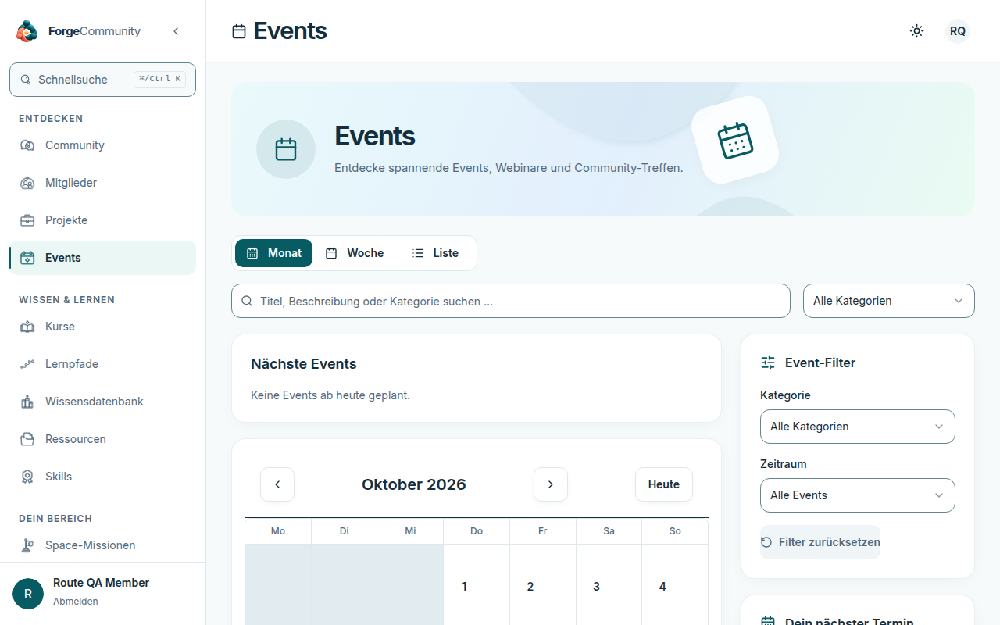</a>
<h3>Events</h3>
<p>Explore events in calendar, week or list view. Event time zones, calendar downloads, capacity-aware RSVPs and opt-in waitlists help members plan and participate.</p>
</td>
</tr>
<tr>
<td width="50%" valign="top">
<a href="artifacts/redesign/all-pages-desktop/route-sweep.pw.ts-every-Ap-33234-page-tsx-render-chat-light--desktop-chromium/chat-light.png">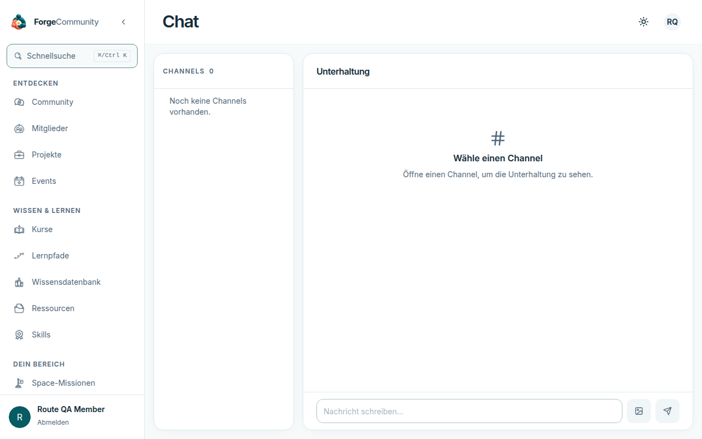</a>
<h3>Chat and notifications</h3>
<p>Channel conversations support message editing and private attachments. A recipient-scoped inbox links members to relevant activity inside the app.</p>
</td>
<td width="50%" valign="top">
<a href="artifacts/redesign/all-pages-desktop/route-sweep.pw.ts-every-Ap-a9e68-ge-tsx-render-search-light--desktop-chromium/search-light.png">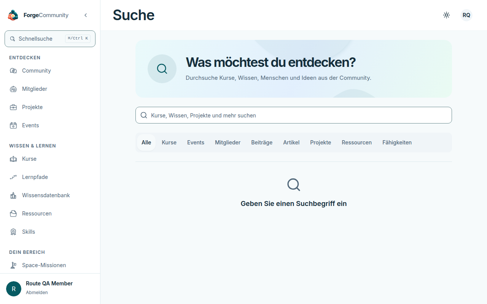</a>
<h3>Search and discovery</h3>
<p>One search spans courses, events, people, discussions, articles, projects, resources and skills. Dedicated directories add category, role, topic and skill filters.</p>
</td>
</tr>
</table>

### Run and personalize your community

<table>
<tr>
<td width="50%" valign="top">
<a href="artifacts/redesign/all-pages-desktop/route-sweep.pw.ts-every-Ap-89ee5-nder-admin-dashboard-light--desktop-chromium/admin-dashboard-light.png">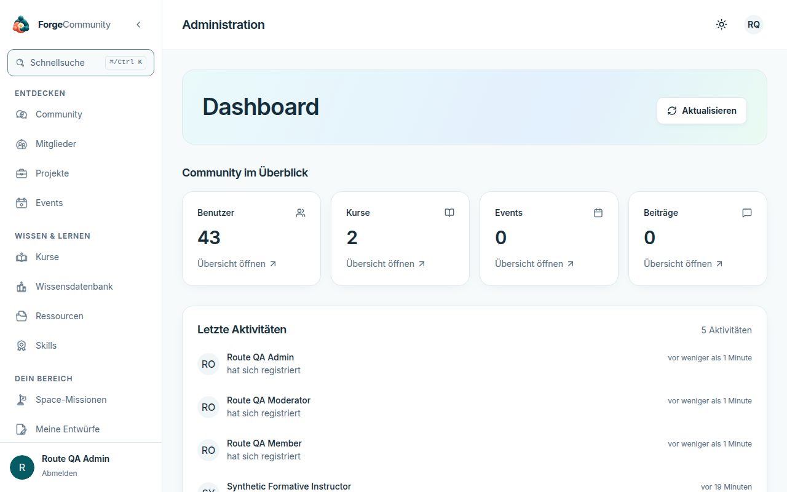</a>
<h3>Administration and moderation</h3>
<p>Role-limited admin tools manage members, courses and learning pathways. Moderators review reported content; instructors manage course teaching workflows.</p>
</td>
<td width="50%" valign="top">
<a href="artifacts/redesign/all-pages-desktop/route-sweep.pw.ts-every-Ap-2a86f--tsx-render-settings-light--desktop-chromium/settings-light.png">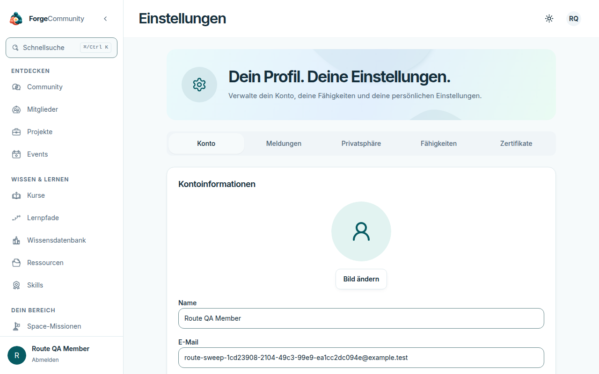</a>
<h3>Accounts and personal interface</h3>
<p>Members register, manage their profile and choose light or dark mode. Forge Spark, the optional learning companion, has browser-local visibility and motion controls.</p>
</td>
</tr>
</table>

See the [full route contact sheet](artifacts/redesign/all-pages-desktop-contact-sheet.jpg),
[mobile and dark-mode screenshots](artifacts/redesign/README.md), and the
[screenshot provenance gallery](docs/ui/README.md) for capture dates, sources
and visual verification notes. The Home illustration is fictional generated
artwork. The feature descriptions above reflect the app's current boundaries;
the notes below cover a few useful product limits.

### Useful to know

- Free self-enrollment is supported; displayed course prices do not include a
  checkout or paid-access workflow.
- A public Space is readable by signed-in members. Private Spaces require
  current membership or an administrator role; admins manage Space membership.
  Joining a Space does not automatically join a mission.
- Practice requires a pool published for the current course version and each
  learner's opt-in. Its questions are plain-text single choice. H5P supports
  importing and playing packages; it does not include an H5P editor.
- Chat and the notification inbox poll the server. Email, digests and external
  push delivery are not configured. Waitlist promotions appear in the app.

<a name="deployment"></a>

## Quick start

The default Docker Compose stack runs one app container with SQLite. You need
Git, Docker and Docker Compose.

```bash
git clone https://github.com/storminator89/forgeCommunity.git
cd forgeCommunity
cp .env.example .env
openssl rand -base64 32
```

Copy the generated value into `NEXTAUTH_SECRET` in `.env`. Keep
`NEXTAUTH_URL` and `NEXT_PUBLIC_APP_URL` at `http://localhost:3013` for a local
installation, then start the app:

```bash
docker compose up --build -d --wait
docker compose ps
```

Open [localhost:3013](http://localhost:3013) and create an account. Startup applies
the SQLite migrations and checks database readiness; it does not seed demo accounts.

**Use a fresh database.** Existing databases with older, pre-publication courses
are not automatically upgraded. Back them up and provision a new empty database;
do not reset them. See the [database compatibility guide](docs/COURSE-PUBLICATION-STORAGE.md).

### Configuration and persistent data

Use [`.env.example`](.env.example) as the configuration reference. Never commit
`.env` or reuse example secrets. Google login is optional; leaving both Google
OAuth values blank disables it.

- In production, set both app URLs to the canonical HTTPS origin.
- Enable `TRUST_PROXY` only behind a trusted proxy that overwrites forwarded
  client headers.
- SQLite needs a local persistent filesystem and one app instance per database
  file. Do not share the file over a network filesystem or across containers.
- Back up all three default volumes: `sqlite_data` (database, private H5P
  packages and course images), `uploads` and `private_uploads` (chat attachments).
  `docker compose down --volumes` deletes their data. Use a consistent SQLite
  backup or stop writes and preserve the database together with its journal/WAL state.

The supported Docker startup and `npm start` also run practice-data retention.
Inactive private practice history becomes deletion-eligible after 12 calendar
months; technical answer receipts after 90 days. Startup removes already eligible
data before serving. Back up and verify recovery first. See the
[practice retention policy](docs/formative-practice-learner.md#retention-and-operation).

<details>
<summary>Deploy with PostgreSQL instead</summary>

Use [`docker-compose.postgresql.yml`](docker-compose.postgresql.yml). In `.env`,
set an independent strong `POSTGRES_PASSWORD`, the matching `POSTGRES_USER` and
`POSTGRES_DB`, and a `DATABASE_URL` using the Compose service hostname `db` and an
explicit schema target, for example `?schema=public`.
The explicit Compose stack selects the PostgreSQL provider at build and runtime.

PostgreSQL schema initialization is an explicit step. For a **verified empty
schema**, run:

```bash
docker compose -f docker-compose.postgresql.yml build app
docker compose -f docker-compose.postgresql.yml up -d db
docker compose -f docker-compose.postgresql.yml run --rm --entrypoint node app \
  scripts/db-deploy.mjs --initialize-empty-schema
docker compose -f docker-compose.postgresql.yml run --rm --entrypoint node app \
  scripts/assert-course-publication-ready.mjs
docker compose -f docker-compose.postgresql.yml up -d
```

Initialization refuses pre-existing schema objects. The normal entrypoint checks
readiness but does not migrate PostgreSQL on startup. Do not use `prisma db push`
to bypass tracked SQL migrations. Keep the database, `h5p_data`, `course_assets`,
`uploads` and `private_uploads` backed up together. This path does not convert
populated legacy course databases; read the
[storage and compatibility guide](docs/COURSE-PUBLICATION-STORAGE.md) before deployment.

</details>

## Local development

Use Node.js 24 ([`.nvmrc`](.nvmrc)), npm 11 and the committed lockfile. Clone the
repository and prepare `.env` with an independent secret as in the quick start.
Select SQLite **before installation**, so postinstall generates the matching
Prisma client:

```bash
export DATABASE_PROVIDER=sqlite
export DATABASE_URL="file:$PWD/data/forge.db"
mkdir -p data
npm ci
npm run db:deploy
npm run db:publication:ready
npm run dev
```

Use a new, empty database at that absolute path. Exported values override the
placeholder in `.env`. The development server runs on port 3013.

`npm run dev` does not start the retention worker. New learner-practice writes
require a recent worker heartbeat; to exercise practice end to end, use Docker
or the production startup path:

```bash
npm run build
npm start
```

Keep provider/database settings consistent for generation, build and runtime.
After switching providers or editing `prisma/schema.prisma`, run
`npm run db:generate`. The PostgreSQL schema is canonical; the SQLite schema is
generated. Keep private course images in persistent `data/course-assets` storage
outside `public/`, or set `COURSE_ASSET_STORAGE_PATH` to another private location.

## Technology

Next.js 16 App Router · React 19 · TypeScript · Tailwind CSS 4 · Radix/shadcn UI ·
NextAuth.js 4 · Prisma 7 · SQLite or PostgreSQL

## Documentation

- Learning: [course editor](docs/COURSE-EDITOR.md),
  [chapter releases](docs/CHAPTER-RELEASES.md),
  [prerequisites](docs/COURSE-PREREQUISITES.md),
  [H5P](docs/H5P.md) and [learning pathways](docs/VERIFIED-LEARNING-PATHWAYS.md)
- Practice: [authoring](docs/formative-practice-authoring.md),
  [learner controls and retention](docs/formative-practice-learner.md)
- Community: [Spaces](docs/SPACES.md),
  [cooperative missions](docs/COOPERATIVE-MISSIONS.md),
  [mission bookmarks](docs/PRIVATE-MISSION-BOOKMARKS.md),
  [polls](docs/SPACE-POLLS.md) and [accepted solutions](docs/ACCEPTED-SOLUTIONS.md)
- Participation: [event waitlists](docs/EVENT-WAITLIST.md),
  [notifications](docs/ACTIONABLE-NOTIFICATION-INBOX.md) and
  [reward rules and private goals](docs/RESPONSIBLE-REWARDS.md)
- Project reference: [design system](design.md),
  [screenshots](docs/ui/README.md), [route inventory](e2e/route-sweep-manifest.ts),
  [database compatibility](docs/COURSE-PUBLICATION-STORAGE.md) and
  [CI workflow](.github/workflows/ci.yml)

<a name="testing-and-evidence"></a>

## Contributing

Found a bug or have an idea? [Open an issue](https://github.com/storminator89/forgeCommunity/issues).
Focused pull requests with relevant regression tests are welcome.

```bash
npm run typecheck
npm run lint -- --max-warnings 0
npm test -- --runInBand
npm run test:styles
npm run test:next-eslint-fork
```

Database-backed tests require a SQLite-generated client and a disposable SQLite
database. Regenerate for your intended provider before building. Use the
[CI workflow](.github/workflows/ci.yml) for the full ordered checks and disposable
browser-test setup; never target a personal or production database. For dependency
changes, follow the [Next ESLint fork maintenance guide](docs/NEXT-ESLINT-FORK.md).
Mention any checks you could not run in your pull request.

## License

Licensed under the [Apache License 2.0](LICENSE).
