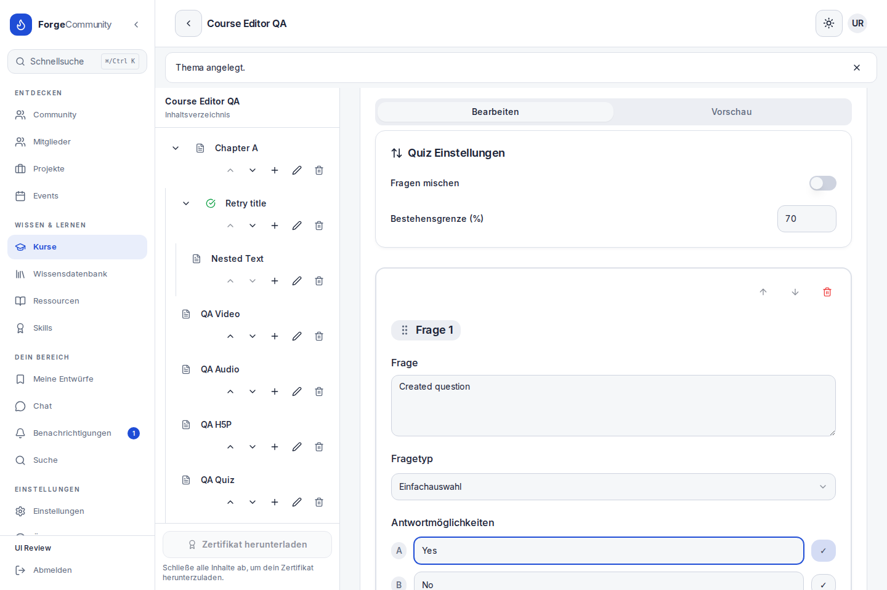
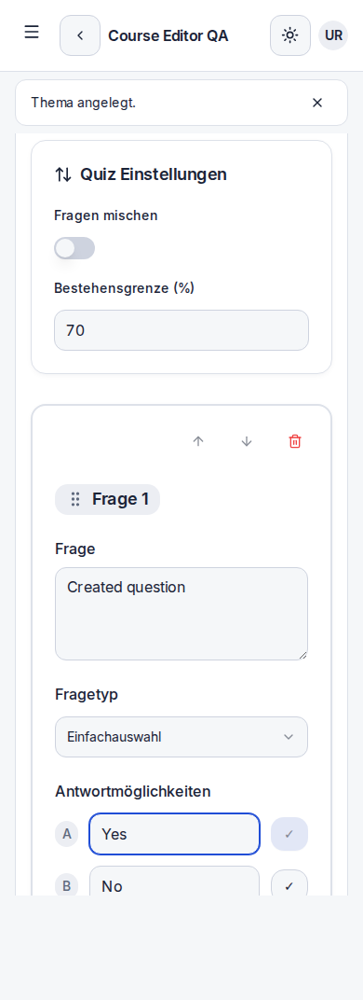

# Kurseditor: private Entwürfe und Veröffentlichungen

Phase 2 trennt drei Zustände: lokale, noch nicht gespeicherte Eingaben; den serverseitig gespeicherten **privaten Kursentwurf**; und die **veröffentlichte Version**, die Lernende sehen. Ein neuer Kurs beginnt als privater Entwurf. **Speichern** ändert die Live-Version nicht. Erst die ausdrückliche Veröffentlichung nach einer Prüfung macht den gespeicherten Stand sichtbar.

## Autorenreise

1. Unter `/courses/authoring` (**Meine Kursentwürfe**) einen eigenen Kurs öffnen oder über **Neuer Kursentwurf** anlegen. Diese Liste zeigt auch unveröffentlichte Kurse und weist auf unveröffentlichte Änderungen hin. Die nur nach Anmeldung erreichbare Kursübersicht enthält ausschließlich veröffentlichte Kurse.
2. Im Autorenarbeitsplatz **Kursdaten** oder einen Eintrag in der verschachtelten Kursstruktur bearbeiten. Kapitel und Themen können hinzugefügt, umbenannt, verschoben, sortiert und aus dem Entwurf entfernt werden. Bei Texten, Video, Audio, H5P und Quiz speichert die jeweilige Aktion den privaten Entwurf. Kursdaten haben **Entwurf speichern**. Ein hochgeladenes Bild muss anschließend noch als Kursbild im Entwurf gespeichert werden.
3. Mit **Vorschau** den Entwurf ausprobieren, auch mit einer lokalen ungespeicherten Änderung am ausgewählten Inhalt. Quizantworten und Abschlussaktionen dort erzeugen weder Lernversuche noch Fortschritt oder Zertifikate. **Lernen** öffnet die aktuelle veröffentlichte Fassung und ist vor der ersten Veröffentlichung nicht verfügbar.
4. Lokale Änderungen speichern oder verwerfen. **Änderungen veröffentlichen** beziehungsweise **Veröffentlichung prüfen** öffnet die serverseitige Prüfung. Sie zeigt Sperrgründe und die Zahl hinzugefügter, entfernter, geänderter sowie umbenannter/neu sortierter Inhalte. Sie nennt die Zahl eingeschriebener Lernender und mögliche Folgen für Abschluss und Belohnungen. Nur der gespeicherte Entwurf wird veröffentlicht; lokale Änderungen sperren die Veröffentlichung.
5. Bei einer bereiten Prüfung im Dialog **Änderungen veröffentlichen** bestätigen. Danach ist die neue Version die Live-Version für alle Lernenden. Eine Prüfung ohne anschließenden Veröffentlichungs-Klick ändert den Live-Kurs nicht.

Die Prüfung kann unter anderem fehlende Titel, leere lernbare Inhalte, ungültige Medienquellen, unvollständige Quiz und nicht erreichbare oder fremde Kursdateien blockieren. Der Kurs kann dennoch als privater Entwurf weiterbearbeitet werden. Die Kursübersicht **Lernpfad im Kurs** hilft bei der Strukturpflege, ersetzt die Veröffentlichungsprüfung aber nicht.

## Versionen, Konflikte und Lernende

- **Versionen** zeigt frühere Veröffentlichungen. **Als Entwurf wiederherstellen** ersetzt den aktuellen privaten Entwurf mit einer Kopie der gewählten Version. Der Live-Kurs bleibt gleich, bis der wiederhergestellte Entwurf erneut geprüft und veröffentlicht wird.
- **Entwurf verwerfen** setzt einen bereits veröffentlichten Kurs auf die Live-Fassung zurück. Bei einem noch nie veröffentlichten Kurs leert es den Entwurf; der Kurseintrag bleibt bestehen. Beide Aktionen betreffen keine ältere Veröffentlichung.
- Wenn ein anderer Autor denselben Entwurf oder die Veröffentlichung inzwischen geändert hat, fordert der Arbeitsplatz zum Vergleichen oder erneuten Laden auf. Lokale Eingaben werden nicht still zusammengeführt. Vor Navigation aus ungespeicherten Eingaben wird gewarnt; der bereits gespeicherte private Entwurf bleibt erhalten.
- Lernende und die Kursansichten angemeldeter Mitglieder folgen ausschließlich der neuesten aktiven Veröffentlichung. Neue oder geänderte lernbare Inhalte können den aktuellen Abschlussstatus verändern. Ein geänderter Inhalt muss in der aktuellen Fassung erneut abgeschlossen werden; bei Quiz kann eine neue Bewertung Freigaben und Belohnungen beeinflussen. Bisherige Lernaktivitäten bleiben erhalten. Bereits ausgestellte Zertifikate bleiben als historische Nachweise gültig; neue werden nicht automatisch ausgestellt.
- Lernende erhalten weder private Entwurfsdaten noch Versionsverlauf oder Autorenaktionen. Kostenpflichtige Kurse haben weiterhin keinen integrierten Checkout; die bestehende kostenlose Selbsteinschreibung ist der unterstützte Beitritt.

## Private Kursbilder

Neue Titelbilder und Bilder in Textinhalten werden kursbezogen außerhalb von `public/` gespeichert. Autoren und Administratoren können sie im Entwurf laden. Für andere wird ein Bild erst über eine Referenz in der aktiven Veröffentlichung zugänglich: ein aktives Titelbild über die öffentliche Kursansicht, ein Bild im veröffentlichten Textinhalt nur für eingeschriebene Lernende. Ein bloßer Upload, eine private oder alte Versionsreferenz macht ein Bild nicht öffentlich. Bereits vorhandene öffentliche oder externe Bild-URLs bleiben unter ihren bisherigen Adressen erreichbar. Sichere, persistente Speicherung und gemeinsame Sicherung mit der Datenbank sind erforderlich; siehe [Staged publication storage](COURSE-PUBLICATION-STORAGE.md) und [Deployment](../README.md#deployment).

## Betrieb und Entwicklung

Diese Phase unterstützt nur eine **frische leere Datenbank**. SQLite-Migration `0010_staged_course_publication.sql` beziehungsweise PostgreSQL-Upgrade `0009_staged_course_publication.sql` legen Entwürfe, unveränderliche Veröffentlichungen, Veröffentlichungsbelege, private Kursdatei-Metadaten und die Kurs-Zeiger an. Beim Anlegen werden Kurs und erster Entwurf in einer Transaktion gespeichert. Vor dem Start mit derselben `DATABASE_PROVIDER`- und `DATABASE_URL`-Konfiguration `npm run db:publication:ready` ausführen. Der schreibgeschützte Check prüft die vollständige Migrationshistorie samt Prüfsummen, vorhandene Entwürfe für jeden Kurs und gültige aktive Veröffentlichungszeiger. Container- und Standalone-Start verweigern bei einem Fehlschlag den Dienst; die Health-Route weist fehlende Entwürfe ebenfalls zurück.

Eine alte Entwicklungsdatenbank mit Kursen ohne Entwurf kann trotz additiv angewendeter Migrationen den Check nicht bestehen. Vor einem Wechsel sichern und eine neue leere Datenbank bereitstellen. Startskripte löschen oder konvertieren diese Daten nicht automatisch. Die genaue Provider-Reihenfolge und die privaten Storage-Volumes stehen im [README](../README.md#local-development) und in [Staged publication storage](COURSE-PUBLICATION-STORAGE.md).

Quiz werden in der Autorenoberfläche als `QUIZ` geführt; die materialisierte Inhaltsprojektion speichert sie für das bestehende Schema weiterhin als `TEXT` mit JSON. Die öffentliche Antwortdarstellung lässt Lösungsschlüssel weg. Veröffentlichungsaufrufe prüfen Entwurfsrevision und aktuelle Live-Version und verwenden eine Anforderungs-ID, damit eine Wiederholung desselben Aufrufs nicht versehentlich eine weitere Version erzeugt. Veraltete Lernfortschritts- oder Quiz-Anfragen werden gegen die aktuelle Veröffentlichung abgewiesen.

## Prüfung und Bildnachweise

Die älteren Testzahlen und Screenshots unten stammen aus der früheren Editor-Ausbaustufe; sie belegen **nicht** den phase-2-Stand. Die neuen Entwurfs- und Veröffentlichungsbilder im [README](../README.md#screenshots) stammen aus einem realen Browserlauf der Phase 2 mit synthetischen Daten in einer ausdrücklich wegwerfbaren SQLite-Datenbank; [Provenienz, Pixelprüfung und Grenzen](ui/README.md) sind dokumentiert. Dieser erste Lauf bestand den neuen Editor-Browserfall auf Desktop und 320px, aber der Gesamtworkflow war wegen veralteter Fixture-Erwartungen in zwei anderen Prüfungen rot. Für die tatsächliche Abnahme sind die Qualitäts-, Sicherheits-, Browser- und PostgreSQL-Laufzeitprüfungen des [CI-Workflows](../.github/workflows/ci.yml) am jeweils letzten PR-Head zu prüfen. Es gibt keine Prüfung auf einer persönlichen oder produktiven Datenbank. Die Bilder allein belegen weder alle Kurszustände noch eine vollständige Barrierefreiheitsabnahme.

Die frühere integrierte Editor-Prüfung meldete vor ihrem ergänzten Browserfall 148 Testsuiten und 1.229 Tests sowie bestandene Lint-, Typ- und Stilprüfungen. Der damals ergänzte Browserfall war zum Zeitpunkt dieses früheren Berichts noch nicht in CI ausgeführt. Diese Zahlen sind historische Kontextinformation und kein Testnachweis für die gestufte Veröffentlichung. Die Vorschau prüft auch keine tatsächliche Wiedergabe externer Video-, Audio- oder H5P-Quellen; dafür müssen die Quellen erreichbar sein.

### Historische Editor-Ansichten (vor Phase 2)

Diese Bilder zeigen den früheren Kurseditor, **nicht** den privaten Entwurfs- und Veröffentlichungsablauf. Sie bleiben zur Nachvollziehbarkeit erhalten und werden nicht als neue Phase-2-Captures ausgegeben.

## Kapitel nach Datum freigeben

Ein Kapitel der obersten Ebene kann unter **Kapitelfreigabe** ein Freigabedatum erhalten. **Freigabe speichern** speichert nur den privaten Entwurf. Die Veröffentlichung zeigt geänderte Freigaben mit bisherigem und neuem Datum; erst **Änderungen veröffentlichen** übernimmt sie für alle eingeschriebenen Lernenden.

Die Freigabe beginnt am gewählten Tag um **00:00 UTC**. Alle Unterthemen erben sie. Ein leeres Datum bedeutet sofortigen Zugriff. In einem Unterthema führt die Freigabeanzeige zum zuständigen Kapitel. Verschobene Inhalte folgen dem Zielkapitel; beim Verschieben auf die oberste Ebene beginnen sie ohne eigenes Freigabedatum. Start- und Enddatum des Kurses bleiben reine Metadaten.

Bis zur Freigabe sehen Lernende Titel und Termin, aber keine Inhaltskörper oder Abschlussaktionen. **Zugriff neu prüfen** oder erneutes Laden holt den aktuellen Serverstand. Weitere Lernvoraussetzungen gelten zusätzlich. Ein späteres veröffentlichtes Datum kann auch bereits bearbeitete Inhalte vorübergehend sperren. Bereits erworbene Abschlüsse und Belohnungen zählen bei unveränderter Inhaltsrevision und gültigen Voraussetzungen weiter. Eine zuvor abgegebene Aufgabe darf die Kursleitung auch während der Sperre bewerten; ein gültiges Bestehen zählt als bereits geleistete Lernarbeit. Neue Lernaktionen bleiben gesperrt. Ein neues Zertifikat erfordert zusätzlich die Freigabe aller Kapitel; bereits ausgestellte Zertifikate bleiben gültig. Einzelheiten und Prüfgrenzen: [Kapitelfreigaben](CHAPTER-RELEASES.md).
